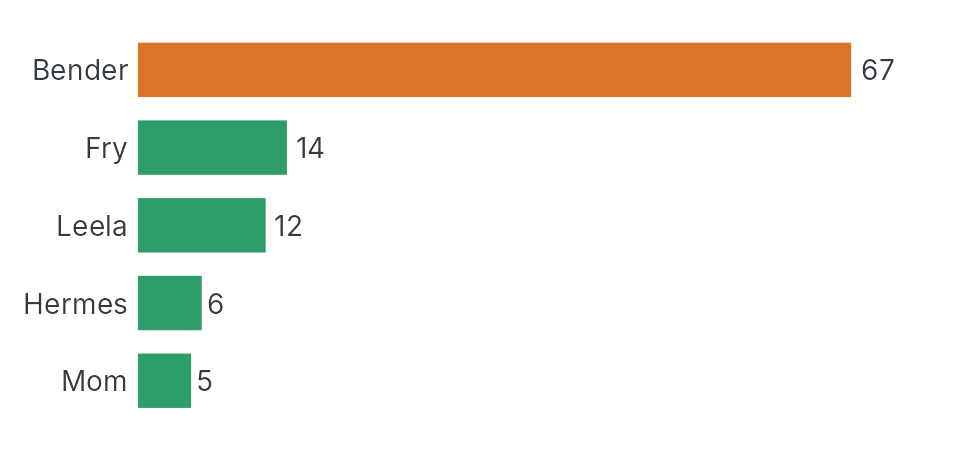

::: {.bottom-line}
**Bottom line.** <!-- TODO: premise and answer up front -->
:::

## His top word is his own name

## Who says "ass" most?

<!--  -->

## Per-word rate by character

<!-- Normalize by total words spoken. -->

## The episode's top ten vs. the real counts

<!-- Left join from the claimed list so zero-count words show up. -->

::: {.callout-note collapse="true"}
## Was it true when the episode aired?

<!-- Cumulative counts in airing order, stopping before "War Is the H-Word". -->
:::

## Methods and limitations

<!-- 137 of 140 original episodes; stop words; stemming; missing lines; tie ranking. -->

<!-- DATA RULES: only aggregated counts live in data/. No scraping code, no
     transcripts, no line-level or token-order data. See README. -->
