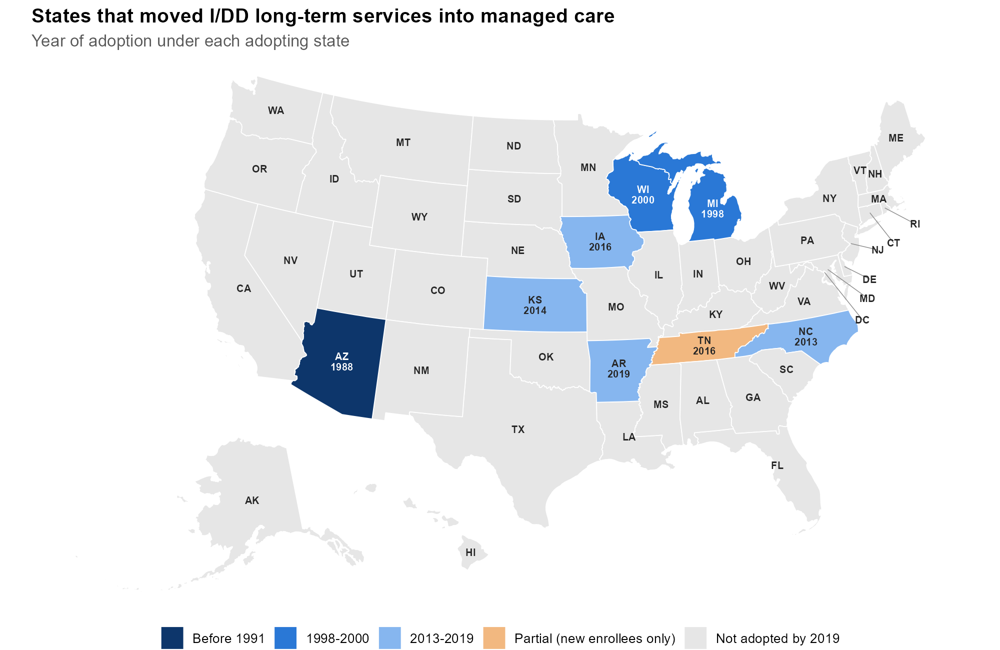
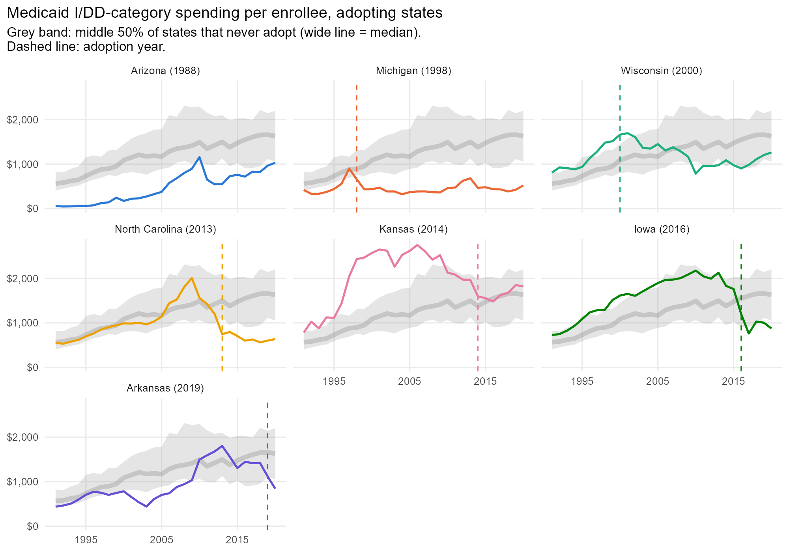
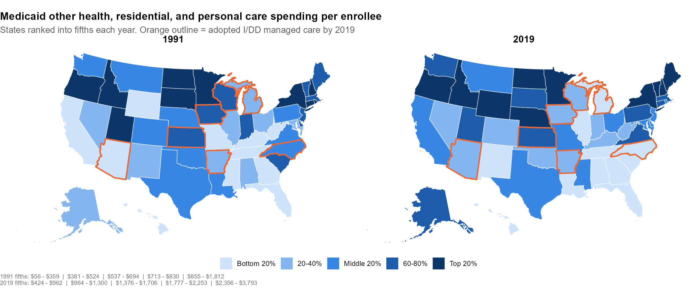
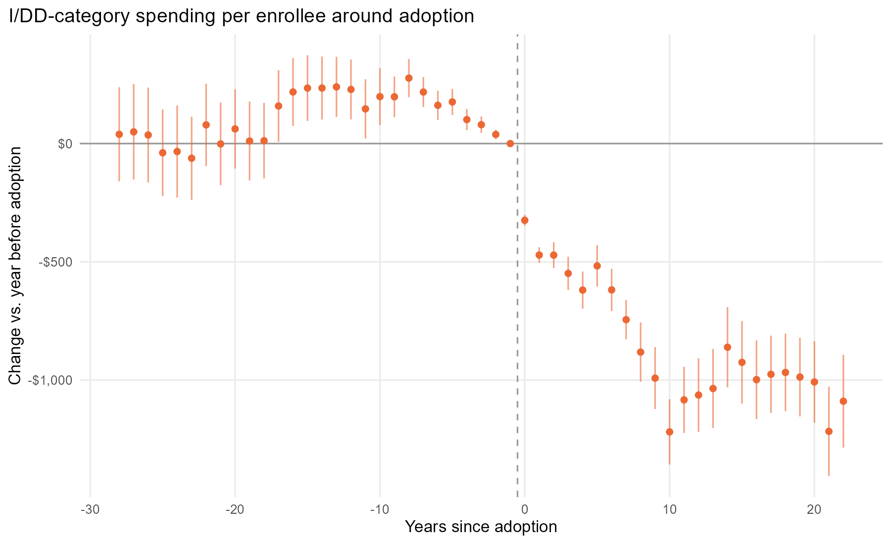
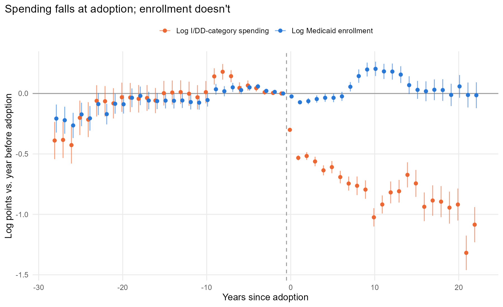
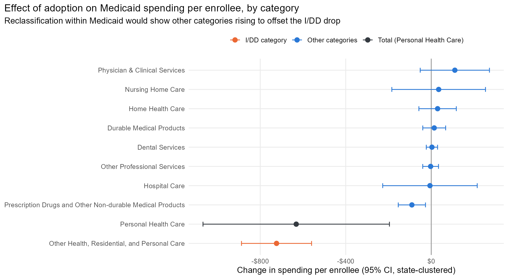
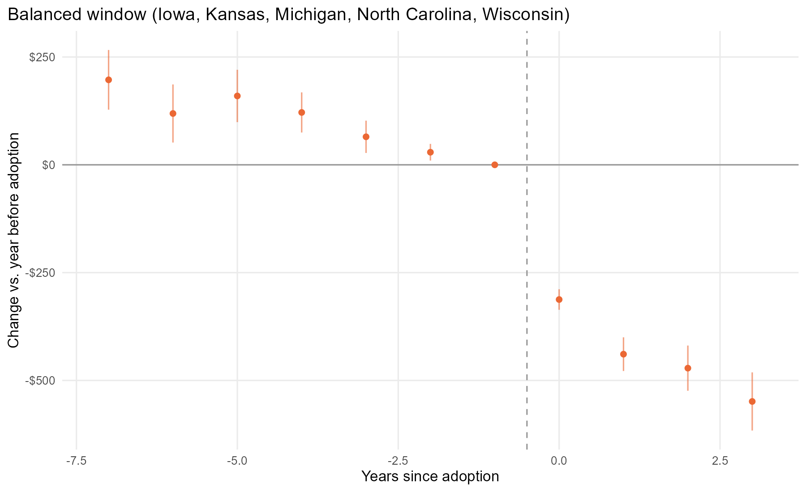
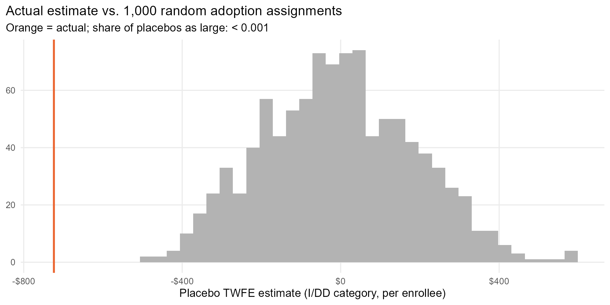

<!--
Writing guide (delete before publishing)
- Two depths: headings, takeaway sentences, and figures carry the whole story
  for a policy reader; callouts hold the detail for a methods reader.
- Headings are questions or claims, not method names.
- Define each technical term once, in plain words, where it first appears.
- Every number in the prose comes from an inline R value (see setup), so it
  always matches results/. Run _analysis/01-04 first.
-->

```{r}
#| label: setup
#| include: false
library(tidyverse)
library(scales)

res <- function(f) read_csv(file.path("results", f), show_col_types = FALSE)
static <- res("static_twfe.csv")
decomp <- res("decomposition_and_placebos.csv")
att    <- res("sunab_att.csv")
es     <- res("event_studies.csv")
ri     <- res("randomization_inference.csv")
cats   <- res("category_effects.csv")
panel  <- read_csv("data/panel.csv", show_col_types = FALSE)
adopt  <- read_csv("data/idd_mco_adoption_years.csv", show_col_types = FALSE) |>
  filter(use_as_treated == "yes") |>
  arrange(adoption_year)

pick <- function(df, out, smp = "1991-2020") filter(df, outcome == out, sample == smp)
usd  <- function(x) dollar(round(x))
pct  <- function(log_pts) percent(exp(log_pts) - 1, accuracy = 1)   # log points -> % change
pval <- function(p) if (p < 0.001) "< 0.001" else format(round(p, 3), nsmall = 3)

# Headline numbers -------------------------------------------------------------
idd       <- pick(static, "mcd_pe_idd")                 # static TWFE, I/DD category
total     <- pick(static, "mcd_pe_total")               # static TWFE, all personal health care
idd_2019  <- pick(static, "mcd_pe_idd", "1991-2019")    # robustness: drop 2020
att_all   <- filter(att, model == "all_years")          # Sun-Abraham, average post effect
att_win   <- filter(att, model == "balanced_window")
win       <- res("event_study_balanced_window.csv")
win_start <- filter(win, rel == -7)$est
win_yr0   <- filter(win, rel == 0)$est
win_yr3   <- filter(win, rel == 3)$est
drift     <- win_start / 6
drift_yr3 <- -drift * 4
spend     <- pick(decomp, "log_mcd_spend_idd")          # log I/DD-category spending
enroll    <- pick(decomp, "log_mcd_enroll")             # log Medicaid enrollment
pe_log    <- pick(decomp, "log_mcd_pe_idd")
mcr       <- pick(decomp, "log_mcr_pe_total")           # Medicare placebo

es_idd    <- filter(es, series == "mcd_pe_idd")
yr0       <- filter(es_idd, rel == 0)
long_run  <- es_idd |> filter(rel >= 10) |> summarise(est = mean(est))
pre_early <- es_idd |> filter(between(rel, -17, -5)) |> summarise(est = mean(est))

offset    <- cats |> filter(role == "Other categories", est > 0) |> summarise(est = sum(est))
n_adopt   <- nrow(adopt)
```

::: {.bottom-line}
**Bottom line.** 
Adopting an MCO model does appear to reduce annual per-enrollee expenditures to IDD waiver services.
:::

<!-- TODO: optional 3-number strip under the bottom line:
     `r usd(idd$est)` per enrollee | enrollment change `r pct(enroll$est)` |
     randomization-inference p = `r pval(ri$ri_p)` -->

## Why states moved I/DD services into managed care

<!-- TODO (about three paragraphs, no jargon):
- What I/DD waiver services are (home and community-based supports for people with
  intellectual and developmental disabilities) and who pays.
- What "managed care" means here: the state pays a plan a fixed amount per person
  (capitation) instead of paying providers per service.
- Why states adopt (budget predictability, care coordination) and what critics worry
  about (plans saving money by limiting services or hours).
- Which states did it and when: table and map below. -->
States moved I/DD services from fee-for-service into managed care for largely the same reasons they've moved other Medicaid programs: more predictable budgets and slower cost growth. Under fee-for-service, the state pays providers for each service delivered, so spending rises with use. Most managed care arrangements instead pay a plan a fixed monthly amount per enrollee, called a capitation rate, and the plan takes on the financial risk of covering everyone's services within it. That should give the state a predictable cost per person and gives the plan a reason to manage care efficiently, through care coordination, shifting services from institutions to community settings, negotiating provider rates. Critics worry the savings can also come from people getting less: plans may approve fewer services, pay less for what they approve, or leave providers with rates so low they deliver fewer hours than authorized.

```{r}
#| label: tbl-adopters
#| tbl-cap: "States that moved I/DD waiver services into managed care"
adopt |>
  transmute(State = state, Program = program, `Year adopted` = adoption_year) |>
  knitr::kable()
```

{#fig-map fig-alt="US map showing the seven states that moved I/DD services into managed care, shaded by when they adopted."}

<!-- TODO: one sentence on how adoption years were coded (statewide, mandatory programs
     only; pilots and voluntary programs excluded; sources in the adoption CSV). -->


## What the spending data shows before any model

<!-- TODO takeaway: one or two sentences. What a reader should see: adopters' spending
     bends down after their adoption year relative to the band of states that never
     adopted. Note Arizona sits low the whole time (adopted 1988, before the data). -->
Adopting states started all over the map, but most ended up spending less per enrollee than they had before, even as typical states kept spending more.

Before adoption, these seven states don't look alike. Arizona and Michigan spent well below the typical range, North Carolina tracked the median, and Kansas and Iowa spent far above it. What they share is what happens next. In Michigan, Wisconsin, North Carolina and Iowa, spending per enrollee in the I/DD category drops around the adoption year and stays down while the grey band keeps climbing, so the gap widens over time. Michigan falls by roughly half right after 1998 and stays flat for two decades.

The timing presents some challenges. In North Carolina, Kansas and Iowa, spending starts falling several years before the adoption year marked here. That could be states preparing for the switch, for example by restructuring waivers or tightening rates ahead of it, or it could mean the coded year is late. It also matters that Kansas, Iowa and North Carolina were spending well above typical states at their peaks, and unusually high spending tends to drift back toward the middle on its own. Those early declines are why the event study below checks for pre-existing trends.  

::: {.panel-tabset}

## All adopters

{#fig-paths fig-alt="Small multiples of each adopting state's I/DD-category spending per enrollee from 1991 to 2020 against the middle-50% band of never-adopting states, with the adoption year marked."}

## Explore a state

```{r}
#| label: paths-to-ojs
#| include: false
band <- panel |>
  filter(is.na(adoption_year)) |>
  group_by(year) |>
  summarise(p25 = quantile(mcd_pe_idd, 0.25), p50 = median(mcd_pe_idd),
            p75 = quantile(mcd_pe_idd, 0.75), .groups = "drop")
ojs_define(paths = select(panel, State, year, mcd_pe_idd, adoption_year), band = band)
```

```{ojs}
//| echo: false
rows = transpose(paths)
bandRows = transpose(band)
adopterNames = [...new Set(rows.filter(d => d.adoption_year !== null).map(d => d.State))].sort()
otherNames = [...new Set(rows.filter(d => d.adoption_year === null).map(d => d.State))].sort()

viewof pick = Inputs.select([...adopterNames, ...otherNames], {label: "State", value: "Michigan"})

selected = rows.filter(d => d.State === pick)
adoptYear = selected[0].adoption_year

Plot.plot({
  height: 380,
  marginLeft: 60,
  x: {label: null, tickFormat: "d"},
  y: {label: "I/DD-category spending per enrollee", grid: true, tickFormat: "$,.0f"},
  marks: [
    Plot.areaY(bandRows, {x: "year", y1: "p25", y2: "p75", fill: "currentColor", fillOpacity: 0.12}),
    Plot.lineY(bandRows, {x: "year", y: "p50", stroke: "currentColor", strokeOpacity: 0.4, strokeDasharray: "4,3"}),
    adoptYear !== null && adoptYear >= 1991
      ? Plot.ruleX([adoptYear], {stroke: "#eb6834", strokeDasharray: "4,3"}) : null,
    Plot.lineY(selected, {x: "year", y: "mcd_pe_idd", stroke: "#eb6834", strokeWidth: 2.5}),
    Plot.tip(selected, Plot.pointerX({x: "year", y: "mcd_pe_idd",
      title: d => `${d.State}, ${d.year}: $${Math.round(d.mcd_pe_idd).toLocaleString()}`}))
  ]
})
```

```{ojs}
//| echo: false
md`${adoptYear === null
  ? `${pick} never adopted managed care for I/DD services.`
  : adoptYear < 1991
    ? `${pick} adopted in ${adoptYear}, before the data start.`
    : `${pick} adopted in ${adoptYear} (dashed line).`} Grey band: middle half of states that never adopted; dotted line: their median.`
```

:::

<!-- Optional, cut if the page runs long: the 1991 vs. 2019 quintile map.
{#fig-quintiles}
-->

## Spending fell after adoption, and kept falling

<!-- TODO takeaway: one plain sentence, then the figure.
Numbers:
- Average effect after adoption (Sun-Abraham): `r usd(att_all$est)` per enrollee
  (SE `r usd(att_all$se)`)
- Year of adoption: `r usd(yr0$est)`; 10+ years after: about `r usd(long_run$est)`
- Simple two-way fixed effects: `r usd(idd$est)` (p = `r pval(idd$p)`); all personal
  health care `r usd(total$est)`; dropping 2020 `r usd(idd_2019$est)`
- Say which states the later years rest on (Michigan and Wisconsin past year 6). -->
Spending per enrollee in the I/DD category fell as soon as states adopted managed care, kept falling for about a decade, and never recovered.

Compared with states that never adopted, adopters' spending dropped by about `r usd(abs(yr0$est))` in the adoption year and kept falling, to about `r usd(abs(long_run$est))` below never-adopters ten or more years later. Averaged over all post-adoption years, the drop is `r usd(abs(att_all$est))` per enrollee. Two cautions: past about seven years, the estimates rest on Michigan and Wisconsin alone, and adopters' spending was already drifting down relative to other states in the years before adoption. "How much should you trust this?" tests whether that earlier drift could explain the drop.

{#fig-es fig-alt="Event-study chart: coefficients near zero or slightly positive before adoption, then falling below zero at adoption and growing more negative over the following decade."}

::: {.callout-note collapse="true"}
## Why not a simple before-and-after comparison?

<!-- TODO (methods reader): states adopted in different years, so a standard two-way
fixed effects regression partly compares late adopters against early adopters that
are already treated, which can bias the estimate when effects grow over time. The
Sun-Abraham estimator compares each adoption cohort only against states that never
adopted, then averages. Arizona is left out of the event study because it adopted
before the data begin. Standard errors are clustered by state. -->
:::

## The drop is spending, not more enrollees

<!-- TODO takeaway. Per-enrollee spending can fall because spending falls or because
enrollment rises. Numbers:
- Log I/DD-category spending: `r pct(spend$est)`
- Log Medicaid enrollment: `r pct(enroll$est)` (p = `r pval(enroll$p)`)
- Per enrollee, in logs: `r pct(pe_log$est)` -->
The per-enrollee expenditures are not better explained by changes in enrollment which remained fairly steady in adopting states.

{#fig-split fig-alt="Two event-study series: spending drops after adoption while enrollment stays flat."}

## The money didn't move to other Medicaid services

<!-- TODO takeaway. If plans had shifted I/DD costs into other categories (physician,
drugs, home health), those categories would rise. Numbers:
- Categories that rose absorb about `r usd(offset$est)` of the `r usd(idd$est)` drop
- Medicare spending per enrollee (a check on the same states' broader health
  spending trends): `r pct(mcr$est)`, p = `r pval(mcr$p)`. One sentence on why it's
  a weak check: Medicare barely pays for these services. -->
Cutting spending in one part of Medicaid can push costs somewhere else, either because services get recorded under a different category or because cuts in one service raise demand for others, such as fewer home supports leading to more hospital or nursing home care. If that were happening, other categories would rise to offset the I/DD drop. They don't. The categories that rose add up to about `r usd(offset$est)`, none of them by a clearly measurable amount, and prescription drugs actually fell slightly. Total spending per enrollee on personal health care fell by `r usd(abs(total$est))`, about `r scales::percent(total$est / idd$est)` of the `r usd(abs(idd$est))` drop in the I/DD category. Nearly all of the change comes from that category.

One shift this can't rule out: these categories cover spending on services only. Any part of a capitated payment that a plan keeps for administration or margin falls outside them entirely.

{#fig-categories fig-alt="Dot plot of the estimated change in each Medicaid category; the I/DD category falls sharply while other categories change little."}

## How much should you trust this?

<!-- TODO: state the pre-trend plainly first. Before adoption, adopters' spending
drifted down relative to other states (about `r usd(pre_early$est)` well before
adoption, moving to zero by the year before). Then each check in one plain sentence. -->
Adopters' spending was already drifting down before adoption: in this window it falls from about `r usd(win_start)` above its pre-adoption level seven years out to zero, roughly `r usd(drift)` a year. That could reflect states preparing for the switch, such as restructuring waivers or holding down rates beforehand, or high spenders drifting back toward the middle. But the drift can't account for what happens at adoption. Holding the comparison to the same five states throughout (Iowa, Kansas, Michigan, North Carolina and Wisconsin), spending drops `r usd(abs(win_yr0))` in the first year alone, about ten times the yearly drift. By year three it is `r usd(abs(win_yr3))` below its pre-adoption level, where the earlier drift alone would have predicted about `r usd(abs(drift_yr3))`. Averaged over the four post-adoption years, the drop is `r usd(abs(att_win$est))`.

### Same states, same window

<!-- TODO takeaway: keeping only the adopters observed from 7 years before to 3 years
after, so every point averages the same states, the effect is `r usd(att_win$est)`
(SE `r usd(att_win$se)`). -->

{#fig-window fig-alt="Event study using only states observed across the full window from seven years before to three years after adoption."}

### Could this happen by chance?

<!-- TODO takeaway: assigning adoption to random states and years 1,000 times, a drop as
large as the real one appears in `r pval(ri$ri_p)` of the draws. -->
With only six adopting states, the usual standard errors aren't reliable, so I checked the result another way: assign the same adoption years to randomly chosen states and see how big an "effect" shows up by chance. I did this `r ri$n_perm` times. None of the random assignments produced a drop as large as the real one (p `r pval(ri$ri_p)`). That makes chance an unlikely explanation, though on its own it can't rule out adopters differing from other states in some other way.

{#fig-ri fig-alt="Histogram of placebo estimates centered near zero, with the actual estimate far in the left tail."}

::: {.callout-note collapse="true"}
## Why randomization inference?

<!-- TODO (methods reader): with only six adopting states in the event study,
state-clustered standard errors are too small and the confidence intervals look more
precise than they are. Randomization inference asks how often a random set of
"adopters" produces an estimate this large, without relying on those standard
errors. -->
Standard errors clustered by state assume there are many independent groups to learn from. Here only six states ever change treatment status, so clustered standard errors tend to be too small and confidence intervals too narrow. Randomization inference sidesteps that problem.

The procedure: take the six real adoption years, shuffle them, and assign them to six states drawn at random from the 50 states and DC (Arizona excluded, since it adopted before the data begin). Re-estimate the two-way fixed effects model on this fake assignment and record the estimate. Repeating this `r ri$n_perm` times builds the distribution of estimates you'd see if adoption had no effect anywhere. The p-value is the share of placebo estimates at least as large in absolute value as the real one.

Two limits. First, it assumes any state could plausibly have been an adopter; if adopters were systematically different, the comparison is less clean. Second, it tests the simpler two-way fixed effects estimate rather than the Sun–Abraham event study, and it doesn't address the pre-adoption drift. That's what the balanced-window check is for.
:::

## What this can't tell us

<!-- TODO (give this room; it's the policy question):
- Lower prices, fewer services, or accounting? Three explanations; this data
  can't separate them. Spending = price x quantity; capitation payments could also be
  recorded outside personal health care (plan administration).
- Few states: six in the event study; the long run rests on Michigan and Wisconsin.
- "I/DD category" is CMS's "other health, residential, and personal care", where
  waiver services are counted, not an I/DD-only line.
- What would answer it: waiver participant counts and cost per participant (State of
  the States in IDD), waiting lists (RISP, KFF), service use from claims (T-MSIS). -->
This analysis shows that spending fell. It can't show whether quality of care changed with it. The limited evidence on experience is mixed: people with I/DD in Illinois managed care described problems with access and navigating the system (Gibbons, Owen, & Heller, 2016), and some family caregivers in four managed-care states reported less flexibility and harder access to services (Williamson et al., 2016). Nor can this data separate lower prices from fewer services: spending can fall because care costs less or because less of it is delivered.

The data also misses money that never reaches services. CMS's personal health care figures exclude administrative costs, including what managed care plans keep for administration and margin. Before drawing policy conclusions, a state would want to confirm that those costs are small enough not to cancel out the savings in service spending.

::: {.content-hidden}
## Methods and code

::: {.callout-note collapse="true"}
## Data, definitions, and code

<!-- TODO: short list.
- Data: CMS State Health Expenditure Accounts by state of residence, 1991-2020
  (Medicaid, Medicare, private insurance, population).
- Outcome: Medicaid spending per enrollee, "other health, residential, and personal
  care" (CMS code 10).
- Treatment: year of statewide, mandatory managed care for I/DD waiver services.
- Estimators: two-way fixed effects; Sun-Abraham event study; randomization inference.
- Full pipeline: link below. -->

The full pipeline (panel build, estimates, figures, and maps) is in
[`projects/mco-medicaid/_analysis`](https://github.com/sean-hudson-data/sean-hudson-data.github.io/tree/main/projects/mco-medicaid/_analysis).

The core estimate:

```{r}
#| label: twfe
#| code-fold: false
library(fixest)
fit <- feols(mcd_pe_idd ~ adopted | State + year,
             data = panel, cluster = ~State)
etable(fit)
```

The event study adds one term:

```{r}
#| label: sunab-code
#| eval: false
#| code-fold: false
feols(mcd_pe_idd ~ sunab(cohort, year) | State + year,
      data = filter(panel, State != "Arizona"), cluster = ~State)
```
:::
:::
